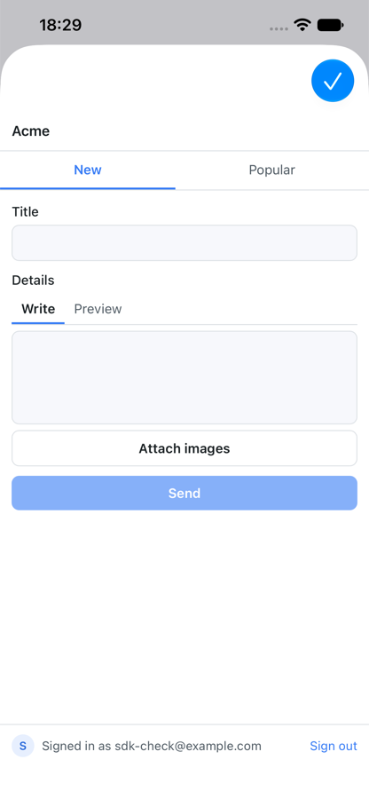
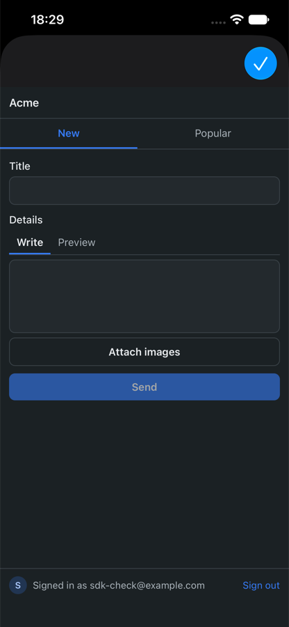

# AntNexo for iOS and macOS

Put your [AntNexo](https://antnexo.com) feedback board, roadmap and What's new inside your Swift app. People post
ideas and bugs, vote, follow the roadmap and read your release notes without leaving the app. Every post carries the
app's version, OS and device model, so you know where it came from.

<p>
  
  
</p>

- iOS 15+ and macOS 12+, Xcode 16+ (Swift 6 toolchain), no dependencies
- SwiftUI, UIKit and AppKit
- The person can post as a guest (where your workspace allows it), sign in with an email code, Google or GitHub, or be
  signed in by your app (identify)
- 25 languages; light and dark follow the system
- MIT licence

## Install

Swift Package Manager: in Xcode, **File → Add Package Dependencies…** and paste
`https://github.com/AntNexo/antnexo-swift`. Or in `Package.swift`:

```swift
.package(url: "https://github.com/AntNexo/antnexo-swift", from: "1.2.0")
```

and add `AntNexo` to your target's dependencies.

## Show the sheet

Configure once at launch with your workspace's board host. Use `https://<slug>.antnexo.com`: it works on every plan and
keeps working if you add or change a custom domain.

```swift
import AntNexo

try AntNexo.configure(host: URL(string: "https://acme.antnexo.com")!, workspace: "acme")
```

**SwiftUI**

```swift
struct SettingsView: View {
    @State private var feedback = false

    var body: some View {
        Button("Send feedback") { feedback = true }
            .antnexoFeedback(isPresented: $feedback)
    }
}
```

**UIKit / AppKit**

```swift
await AntNexo.show()                       // from the top-most view controller / the key window
await AntNexo.show(from: self, tab: .roadmap)
AntNexo.close()                            // closes it from code, as Done does
```

`show` returns whether a sheet was presented (`false` before `configure`, while one is already up, or with nothing to
present from).

Tabs: `.new`, `.popular`, `.roadmap`, `.changelog`. More options at `configure`:

```swift
try AntNexo.configure(host: host, workspace: "acme", options: FeedbackOptions(
    tabs: [.new, .roadmap, .changelog],   // which tabs, in that order
    boards: ["ideas", "bugs"],            // which boards
    theme: .auto,                         // .light, .dark or .auto (the default)
    color: "#4f46e5",                     // accent
    prompts: true,                        // your team's in-app questions
    whatsNew: .badge,                     // .badge, .popup or .off
    language: nil                         // by default the app's language
))
```

## Sign the person in from your app (identify)

If your app has its own accounts, sign the person in to the board as themselves: your **backend** signs a short-lived
HS256 JWT with the workspace's identify secret (admin → workspace settings → Widget → Identify secret) — `sub`,
`email`, `exp` (≤ 24 h), optionally `name`, `company`, `mrr` — and the app fetches it when the sheet opens:

```swift
AntNexo.identify { @Sendable in
    try await MyAPI.shared.antnexoToken()   // your endpoint; return nil to open the sheet signed out
}
```

The provider is called each time the sheet opens; if it fails, returns nil or takes longer than 10 seconds, the sheet
opens anyway and the person can sign in our way. **Never put the identify secret in the app.** The token goes to the
page through the bridge, never in a URL or a log.

On every account switch (sign out, another user), make the provider stop returning the old person's token and clear
the sheet's session:

```swift
AntNexo.identify(nil)          // or a provider for the new account
await AntNexo.logout()
```

## What's new badge

```swift
let count = try await AntNexo.unreadCount()   // entries the person hasn't seen yet
```

The count is kept in step with the sheet: when the person opens What's new there, `onEvent` reports `.unread(count: 0)`.

## Screenshot

```swift
await AntNexo.show(screenshot: true)
```

Takes a screenshot of the app as it is (before the sheet opens) and offers it as an attachment on the new post. The
person sees it and can remove it; it is uploaded only when they send, only when they are signed in and your workspace
has attachments on. Off by default: the screen can hold private data. On macOS the window is drawn the way AppKit
caches views, so web, video and Metal content in it may come out blank (a true window capture needs the screen
recording permission, which the SDK doesn't ask for).

## Events

```swift
AntNexo.onEvent = { event in
    switch event {
    case .posted(let id): print("new post", id)
    case .unread(let count): badge = count
    case .signedIn(let yes): print("signed in:", yes)
    case .identifyFailed(let code): print("identify refused:", code)   // e.g. an expired token
    case .closed: break
    }
}
```

## Privacy

Nothing personal is sent before the sheet opens: the only earlier request is the public changelog, when you call
`unreadCount()` for a badge. With a post the SDK sends the app's name, version and build, the OS and
its version, the device model (`iPhone16,2`), the locale and the SDK version — no device identifiers, no IDFA, no
tracking. Your workspace shows them on the post in the admin; erasing a person removes them.

## How it works (design notes)

- The sheet is AntNexo's widget in app mode (`<host>/app`) in a `WKWebView` with a small native bridge: features and
  fixes reach your app without an app update. You can also use your own WebView with the same bridge contract.
- The WebView loads only that page once; every other navigation is refused, links open in Safari
  (`SFSafariViewController` on iOS, the default browser on macOS), and new windows are never created.
- The bridge (`window.AntNexoApp`) is injected only into the main frame, and messages are taken only from the main
  frame on your configured host (exact scheme, host and port); each message is validated.
- Google and GitHub sign-in run in the system's sign-in sheet (`ASWebAuthenticationSession`, ephemeral), and only for
  your board's own OAuth start URL. Google refuses sign-in inside embedded WebViews.
- The sheet's web data (the board session) lives in a data store of its own on iOS 17+ / macOS 14+, which `logout()`
  clears. On iOS 15–16 / macOS 12–13 a `<slug>.antnexo.com` board uses the default store and `logout()` removes only
  `antnexo.com` data; a custom-domain board uses a non-persistent store there (its site may hold your app's own web
  data, which logout must not touch), so people sign in again on each opening — another reason to use the slug host.
- Internationalised host names work in either form; the SDK compares origins in their ASCII (`xn--…`) form.
- If the page can't load (offline), the sheet says so and offers Try again.
- A renamed workspace slug changes the host: ship the new one in an update.
- Wrappers of this package (the React Native SDK) set the platform and SDK version the page reports through
  `@_spi(Wrapper) AntNexo.setWrapper(platform:sdk:)`; apps don't call it.

## Sample app

`Examples/Sample` (iOS and macOS): open `Sample.xcodeproj`, set your board in **Edit Scheme → Run → Arguments**
(`-host https://<slug>.antnexo.com -workspace <slug>`) and run. The project is generated with
[XcodeGen](https://github.com/yonaskolb/XcodeGen) from `project.yml`.

## Licence

MIT — see [LICENSE](LICENSE).
